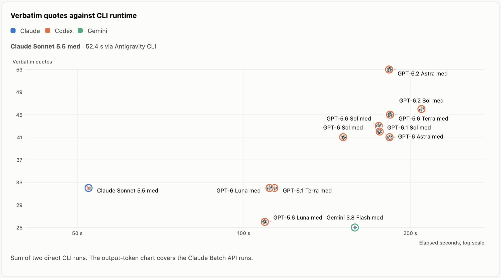
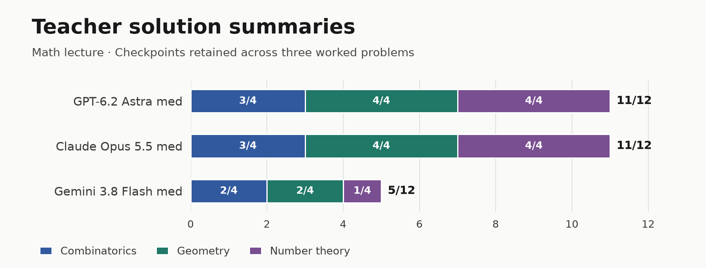

# AI Model Benchmarks

## Magazine article summaries

## Math lecture

### Verbatim quotes

Both charts use the same two excerpts of the non-math portion of the lecture notes, across 47 subtitle blocks. The token chart covers 13 Claude and 10 Codex models. Verbatim quote counts measure one aspect of detail.

Claude Sonnet 5.5 at medium effort produced 32 verbatim quotes in 52.4 seconds across two Antigravity CLI runs.

### Teacher solution summaries

Three models summarized the same worked solutions at medium effort. Two blinded reviewers scored four checkpoints per problem across combinatorics, geometry, and number theory.

