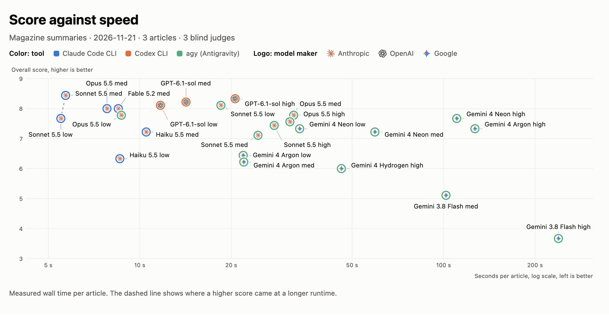
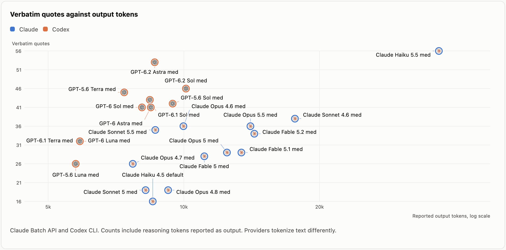

# AI Model Benchmarks

## Magazine article summaries

## Math lecture notes

### Claude and Codex models

Both charts use the same two excerpts of the non-math portion of the lecture notes, across 47 subtitle blocks. The token chart covers 13 Claude and 10 Codex models. Verbatim quote counts measure one aspect of detail.

